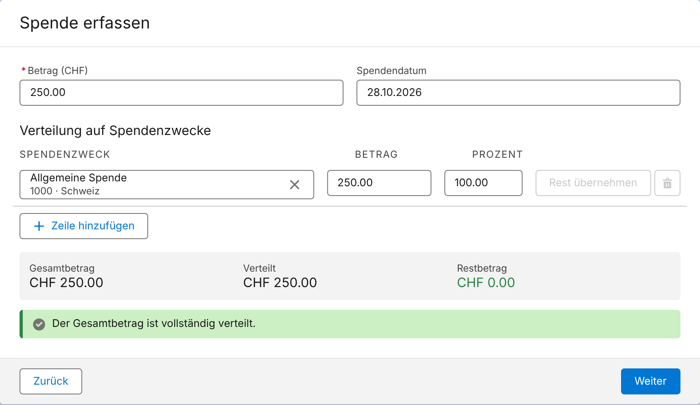
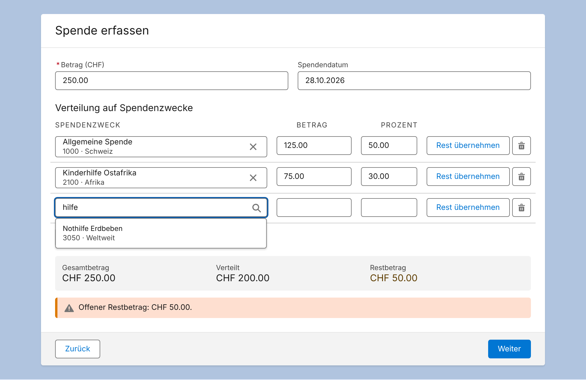
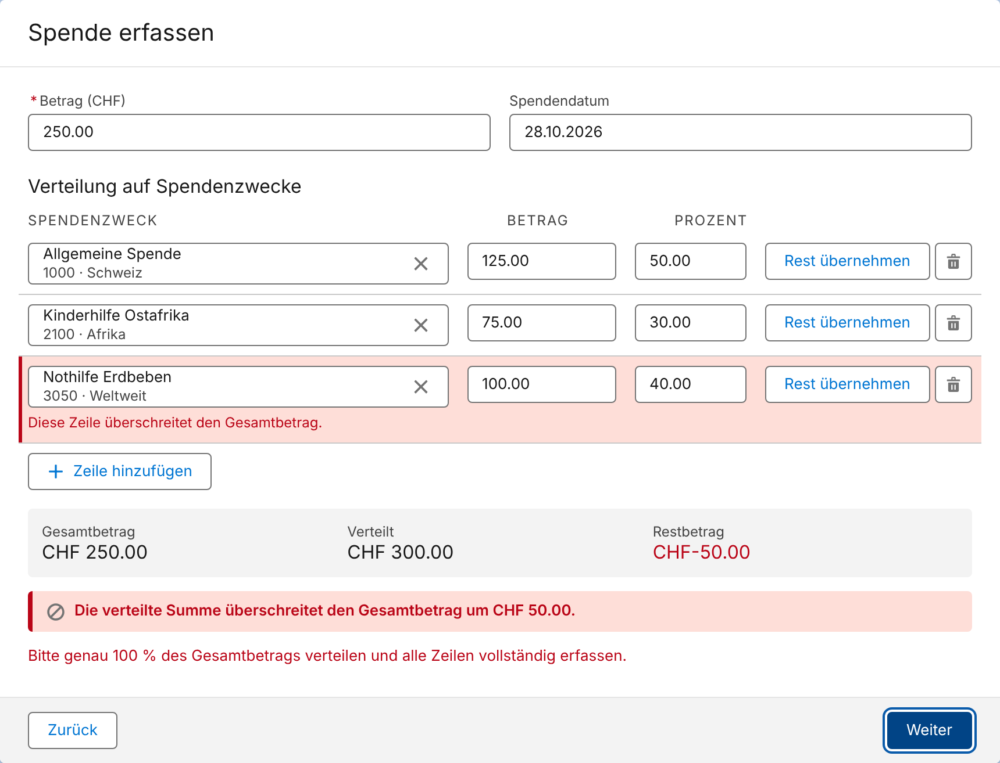
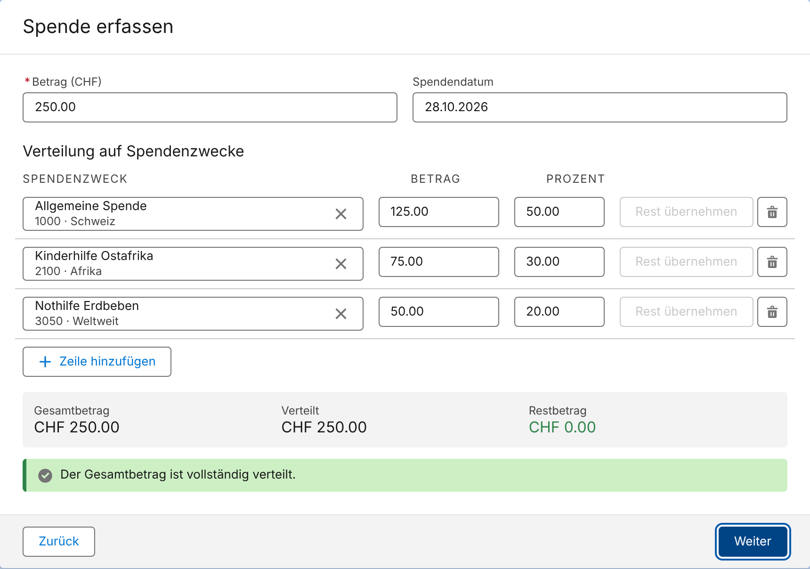
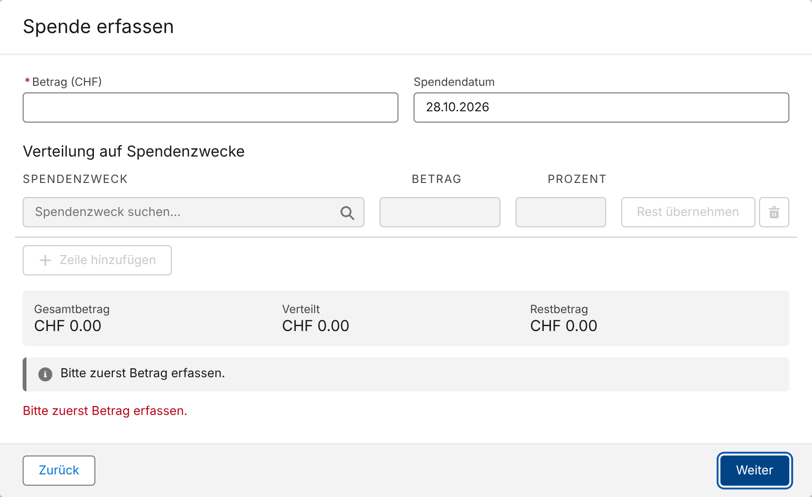

# Gift Designation Split (Screen-Flow-LWC)

Wiederverwendbare Lightning Web Component für Salesforce Nonprofit Cloud. Sie verteilt den Betrag einer
Gift Transaction in einem Screen Flow auf 1 bis max. 10 Gift Designations. Die Komponente speichert nichts
selbst, sondern gibt `GiftTransactionDesignation`-Records an den Flow zurück.

## Inhalt

| Pfad | Beschreibung |
| --- | --- |
| `force-app/main/default/lwc/giftDesignationSplit` | Flow-Screen-Komponente (Zeilen, Berechnung, Validierung, Output) |
| `force-app/main/default/lwc/giftDesignationSplit/splitCalculations.js` | Rechenlogik in Cents (Betrag führend, Prozent abgeleitet) |
| `force-app/main/default/lwc/giftDesignationCombobox` | Clientseitig durchsuchbare Combobox (Child-Komponente) |
| `force-app/main/default/labels` | Custom Labels (`GDS_*`, Master-Sprache Englisch) |
| `force-app/main/default/translations` | Übersetzungen Deutsch (`de`) und Französisch (`fr`) |

## Flow-Konfiguration

**Input**

| Property | Typ | Pflicht | Hinweis |
| --- | --- | --- | --- |
| `totalAmount` | Currency / Number | Ja | Reaktiv, z. B. `Amount` der Gift Transaction oder die Currency-Eingabe auf demselben Screen |
| `availableDesignations` | Record Collection `GiftDesignation` | Ja | Aus Get Records, dort gefiltert und sortiert |
| `displayFields` | Text | Nein | z. B. `Code__c, Region__c` |
| `searchFields` | Text | Nein | z. B. `Code__c` |
| `maxRows` | Integer | Nein | 1–10, Default 10 |
| `defaultDesignationId` | Text | Nein | Vorauswahl in Zeile 1 |

Alle in `displayFields`/`searchFields` genannten Felder müssen im Get Records mitgeladen werden.

**Output**

| Property | Typ | Hinweis |
| --- | --- | --- |
| `designationRecords` | Record Collection `GiftTransactionDesignation` | `GiftDesignationId`, `Amount`, `Percent`; `GiftTransactionId` setzt der Flow nach Anlage der Gift Transaction (Loop + Assignment, dann Create Records). Kann zusätzlich als Input gemappt werden, damit die Verteilung bei „Zurück“ erhalten bleibt. |
| `allocatedAmount` | Currency / Number | Summe der verteilten Beträge |
| `isValid` | Boolean | `true` bei genau 100 % Verteilung |

„Weiter“ wird über die `validate()`-Methode blockiert, solange nicht genau 100 % verteilt sind.

## Verhalten (Kurzfassung)

- Start mit einer Zeile, die den vollen Betrag erhält. Solange diese Zeile die einzige ist und nicht
  bearbeitet wurde, folgt sie Änderungen des Gesamtbetrags.
- Sonst bleiben bei Änderung des Gesamtbetrags die Beträge bestehen; die Prozente werden neu berechnet.
- Betrag ist führend (2 Nachkommastellen); die 100 %-Prüfung erfolgt auf Basis der Beträge (in Cents).
- Output-Prozente werden bei genau 100 % Verteilung so ausgeglichen, dass sie in Summe exakt 100 ergeben.
- Bereits gewählte Designations werden in den anderen Zeilen ausgeblendet.

> Technischer Hinweis: Im `js-meta.xml` sind `totalAmount` und `allocatedAmount` als `Integer` deklariert.
> Das ist laut Salesforce-Schema der einzige numerische Property-Typ für Flow-Screen-Komponenten; Flow Builder
> verknüpft ihn mit Currency- und Number-Ressourcen. Dass Rappenbeträge (z. B. 250.50) unverändert ankommen,
> ist beim ersten Deploy zu prüfen.

## Screenshots

Lokal mit LWC OSS, Lightning Base Components und SLDS gerendert (Flow-Rahmen und Kopffelder nur angedeutet):

| | |
| --- | --- |
| Standardfall |  |
| Split, Suche, Rest offen |  |
| Überschreitung |  |
| Vollständig verteilt |  |
| Kein Betrag |  |

## Mehrsprachigkeit

Alle Texte sind Custom Labels (`GDS_*`). Italienisch kann ohne Codeänderung über die Translation
Workbench oder eine `it.translation-meta.xml` ergänzt werden.

## Entwicklung

```bash
npm install
npm test          # Jest-Tests (sfdx-lwc-jest)
sf project deploy start --source-dir force-app
```
